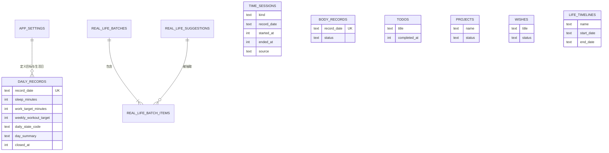

# 人生工作台产品与技术需求说明

> 版本：V2（根据第二轮产品确认修订）  
> 产品定位：**一个以“今天”为核心的个人生活操作台。**  
> 核心体验：**记录我今天做了什么，告诉我今天可以做什么，展示我正在经历什么。**  
> 使用方式：仅在用户自己的电脑上、本地单用户使用  
> 视觉参考：`/Users/qq/Downloads/ChatGPT Image 2026年8月21日 18_21_25.png`

---

## 0. 已确认的产品决定

以下内容已经由用户确认，后续开发不得自行更改：

1. 产品只在自己的电脑上使用，不做账号、登录和多用户系统。
2. 每天凌晨 `04:00` 自动切换到新的一天。
3. 点击“结束今天”只完成总结和仪式动画，不会提前切换日期，也不会锁住数据。
4. 现实生活推荐被勾选时，表示“今天已经做了”。
5. To Do 未完成时一直保留到后续日期，直到完成或删除。
6. 工作和娱乐允许手动补录时间。
7. 项目只有“进行中/已完成”，愿望只有“未实现/已实现”，不做归档。
8. 今日状态由用户手动选择，不由系统评价。
9. 结束今天时允许输入一段可选的今日总结，也允许完全不输入。
10. 每日工作目标和每周健身目标可以在设置中修改，首页读取并显示当前设置。
11. 人生星际图是正式产品功能，不能作为无限期暂缓项。

如果实现过程中需要取消或明显改变上述功能，必须先说明影响并获得用户确认。

---

## 1. 产品定义

人生工作台不是任务管理软件，也不是要求用户维护大量结构化信息的“第二份工作”。

它的核心是：每天打开首页，用很少的操作留下生活证据；随着时间积累，再通过历史、总结和人生星际图把这些证据重新呈现给用户。

### 1.1 首页四个今日模块

1. **推进人生**：记录今天投入工作的时间，以及可选的工作内容。
2. **身体**：记录今天健身、轻运动或不运动。
3. **现实生活**：提供一些今天可以真正去做的生活建议。
4. **娱乐**：记录今天用于娱乐的时间。

### 1.2 四个独立信息模块

1. **To Do**：脑子里当前需要处理的小事情。
2. **项目**：正在推进的长期事项，但不拆任务。
3. **愿望池**：想实现的事情，不设置进度和截止日期。
4. **人生时间线**：正在经历或即将经历的一段人生时间。

To Do、项目、愿望和人生时间线互相独立，不建立外键关系，不互相包含。

### 1.3 数据展示层

**人生星际图**读取上述行为与文本，形成长期可视化。用户不需要为了生成图谱额外维护分类、标签或关系。

### 1.4 产品原则

- 少输入：可选内容不填写也能完整使用。
- 首页优先：核心行为尽可能在首页完成。
- 可以纠错：计时、睡眠和历史记录都允许修改或补录。
- 不做评判：系统展示事实，不评价用户“失败”或“偷懒”。
- 数据透明：星际图中的节点必须能查看它来自哪些真实记录。
- 本地私有：默认不上传任何个人数据，不启用遥测。

---

## 2. 功能范围

### 2.1 正式版本必须包含

- 今日首页及红、白、黑视觉体系
- 睡眠手动记录
- 工作计时、娱乐计时及手动补录
- 身体三选一记录和周目标统计
- 现实生活随机推荐、换一批与完成记录
- 跨天保留的 To Do
- 极简项目和愿望池
- 人生时间线
- 手动选择今日状态
- 设置页中的工作和健身目标
- 凌晨 4 点切日逻辑
- 结束今天、可选文字总结和收束动画
- 历史数据查看与修改
- 可交互的人生星际图
- 本地数据库及自动备份

### 2.2 第一阶段暂缓但不视为缺陷

- 农历
- 深色模式
- 列表拖动排序
- 操作后 5 秒撤销
- 面向用户的数据导出界面
- 定位推荐
- AI 动态推荐
- 工作和娱乐的细分类
- 复杂的项目、愿望和时间线管理页面

“暂缓”不代表从数据库中删除未来扩展可能，但第一阶段不为这些功能增加界面和使用负担。

---

## 3. 页面与导航

| 路径 | 页面 | 说明 |
|---|---|---|
| `/` | 今日首页 | 绝对核心；默认打开当前生活日 |
| `/history` | 历史 | 按生活日查看并修改记录 |
| `/star-map` | 人生星际图 | 正式可交互图谱，不是静态装饰 |
| `/settings` | 设置 | 修改工作目标、健身目标和本地备份设置 |

项目、愿望、时间线的“查看全部”第一阶段使用抽屉或大弹窗，不单独建设复杂页面。

顶部导航只保留：

- 左侧品牌 `My Life`
- 当前手动状态
- 设置入口
- “结束今天”按钮

---

## 4. 生活日与时间规则

### 4.1 生活日定义

产品中的“一天”不是自然日 `00:00–24:00`，而是：

> 当天凌晨 04:00 至次日凌晨 03:59:59。

计算公式：

```ts
lifeDate = localDateTime.minus({ hours: 4 }).toISODate()
```

示例：

| 本地时间 | 所属生活日 |
|---|---|
| 2026-08-21 03:20 | 2026-08-20 |
| 2026-08-21 04:00 | 2026-08-21 |
| 2026-08-22 02:30 | 2026-08-21 |
| 2026-08-22 04:00 | 2026-08-22 |

### 4.2 切日规则

- 到凌晨 4 点时，首页自动切换为新的生活日。
- 如果页面一直打开，前端在 4 点重新获取首页数据，不需要用户刷新。
- 用户是否点击过“结束今天”不影响切日。
- 点击“结束今天”以后仍停留在当前生活日。
- 点击结束以后仍可增加、补录或修改当天数据。

### 4.3 计时跨越 4 点

- 计时不会在 4 点被系统擅自停止。
- 一整段计时归属于开始时所在的生活日。
- 4 点后如果上一生活日的计时仍未结束，新首页显示醒目提示：`上一天的工作仍在计时`。
- 用户可直接结束，或进入修正界面修改结束时间。
- 在旧计时结束前，不能开始新的工作或娱乐计时。

### 4.4 时间存储

- 数据库时间戳统一保存为 Unix 毫秒整数。
- 展示和生活日计算使用 `Asia/Shanghai`。
- 时长由 `ended_at - started_at` 计算，不使用浮点小时。
- 展示格式为 `0m`、`42m`、`1h05m`、`4h12m`。

---

## 5. 首页布局和视觉

### 5.1 桌面结构

首页改为编辑部式三栏单屏工作台：

1. 顶部是品牌、居中日期、今日状态、历史、设置与“结束今天”。
2. 主选项卡只保留：`今日 / 项目 / 星际图`。
3. 今日页左侧竖排：睡眠、工作、娱乐、身体四项摘要。
4. 今日页中栏：推进人生 → 身体状况 → 现实生活 → 娱乐。
5. 今日页右栏：项目 → 愿望池 → 人生时间线 → To Do。
6. 首页不再显示人生星际图预览，星际图通过主选项卡进入独立页面。
7. 在 `1440×900` 及更大桌面窗口中，主要模块必须完整落在一个视口内，不依赖长距离滚动。

页面最大宽度建议 `1520px`，桌面安全边距至少 `26px`，卡片间距 `14–16px`。

### 5.2 移动宽度

虽然产品主要在个人电脑使用，窗口变窄时仍需可用：

- `>= 1120px`：三栏单屏。
- `760–1119px`：概览横向排列，主体双栏。
- `< 760px`：单栏，不允许横向滚动。

### 5.3 视觉令牌

| 令牌 | 建议值 | 用途 |
|---|---|---|
| `--primary` | `#E5151B` | 主按钮、数字、图标、星点 |
| `--primary-hover` | `#C91016` | 主按钮悬停 |
| `--primary-soft` | `#FFF2F2` | 选中状态背景 |
| `--text` | `#171717` | 主文字 |
| `--text-secondary` | `#666666` | 说明文字 |
| `--text-muted` | `#999999` | 次要信息 |
| `--page` | `#FCFCFB` | 页面背景 |
| `--card` | `#FFFFFF` | 卡片背景 |
| `--border` | `#E8E8E5` | 卡片与分隔线 |
| `--danger` | `#B42318` | 删除等危险操作 |

- 卡片圆角 `14px`，输入框和按钮圆角 `10px`。
- 主要数字 `30–36px`，大日期 `44–52px`，正文 `14–16px`。
- 使用线性图标、细边框、极轻阴影和充分留白。
- 红色不能成为唯一状态线索，选中状态同时使用文字或图标。
- 暂不实现深色模式；顶部原太阳图标改成设置入口，避免假按钮。

---

## 6. 今日概览

第一屏显示：

- 月日、完整日期、星期
- 睡眠总时长
- 今日工作累计与目标差值
- 今日娱乐累计
- 今日身体状态与本周健身次数
- 用户手动选择的今日状态

工作差值：

- 未达到：`还差 1h18m`
- 正好达到：`今日目标已完成`
- 超过目标：`已超过目标 42m`

所有累计数字从记录实时计算，不保存第二份可被手动修改的总数。

---

## 7. 功能详细说明

### 7.1 睡眠

点击“编辑”打开小弹窗：

- 小时：`0–24`
- 分钟：`0–59`
- 24 小时时分钟必须为 0
- 保存为总分钟数
- 允许清空记录

第一版不记录入睡和起床时间，不做设备同步。

### 7.2 工作计时

#### 开始

- 按钮：`开始工作`
- 点击后显示可选输入：`现在准备做什么？`
- 内容允许为空，最多 200 字
- 开始成功后显示开始时间和实时增长时长

#### 结束

- 按钮变为 `结束工作`
- 默认结束时间使用服务端本机时间
- 结束后立刻更新今日累计
- 刷新网页或关闭再打开，活动计时仍能恢复

#### 记录列表

默认折叠，展开后显示：

```text
10:03–11:42  1h39m
论文文献整理

13:35–15:16  1h41m
未填写
```

每条记录支持编辑开始时间、结束时间、内容和删除。

#### 补录

工作记录区域提供 `＋ 补录工作时间`：

- 开始日期时间：必填
- 结束日期时间：必填
- 工作内容：可选，最多 200 字
- 保存前显示计算时长
- 不允许结束早于开始
- 不允许与已有工作或娱乐记录重叠
- 归属生活日根据补录的开始时间和凌晨 4 点规则计算

### 7.3 娱乐计时

与工作使用同一套计时与补录逻辑：

- `开始娱乐` / `结束娱乐`
- `＋ 补录娱乐时间`
- 第一版不分类，不要求填写内容
- 允许编辑和删除历史记录

### 7.4 工作与娱乐共同约束

同一时间只能有一个活动计时器，工作与娱乐不能重叠。

工作计时中点击“开始娱乐”时提示：

> 工作仍在计时，是否现在结束工作并开始娱乐？

确认后在同一数据库事务中结束工作并创建娱乐记录，两段时间首尾相接。反方向同理。

单次计时超过 8 小时只提示“可能忘记结束”，不自动截断或篡改数据。

### 7.5 身体

每天三选一：

- 健身
- 轻运动
- 不运动

规则：

- 未选择与“不运动”不同。
- 当天再次选择会替换原状态。
- 健身和轻运动允许添加 100 字以内的可选备注。
- 本周健身次数只统计“健身”，不把轻运动计入。
- 一周按照周一至周日统计，但生活日仍在凌晨 4 点切换。

### 7.6 现实生活推荐

首页显示最多 5 个建议，勾选代表“今天已经做了”。

规则：

1. 首次打开当日首页时生成一批推荐。
2. 同一批不重复。
3. 点击“换一批”生成并保存新批次。
4. 新批次尽量不重复上一批。
5. 换一批不会删除此前已经勾选完成的记录。
6. 第一版使用开发者预置池，至少 30 条。
7. 第一版不读取位置，不使用 AI。

建议池分类：独处、城市探索、轻松娱乐、记录生活。

### 7.7 To Do

To Do 是当前小事列表，不属于任何项目。

- 新建只填写标题，最多 120 字。
- 未完成事项跨生活日一直保留。
- 首页显示全部未完成事项和当前生活日刚完成的事项。
- 勾选后记录完成时间并加删除线。
- 可以取消完成、编辑标题和删除。
- 第一阶段不做优先级、标签、提醒、子任务和拖动排序。

### 7.8 项目

项目保持极简：

- 创建只填写项目名称，最多 80 字。
- 状态只有 `进行中` 和 `已完成`。
- 首页优先显示最近创建的 3 个进行中项目。
- 可修改名称、标记完成或删除。
- 不做归档、百分比进度、任务、成员、描述、开始日期和截止日期。

### 7.9 愿望池

- 创建只填写愿望内容，最多 120 字。
- 状态只有 `未实现` 和 `已实现`。
- 首页显示最近创建的 4 个未实现愿望。
- 可修改内容、标记已实现、恢复为未实现或删除。
- 不做归档、进度、优先级、提醒和截止日期。

### 7.10 人生时间线

字段：

| 字段 | 必填 | 规则 |
|---|---|---|
| 名称 | 是 | 最多 80 字 |
| 开始日期 | 是 | 自然日期 |
| 仍在继续 | 是 | 默认开启 |
| 结束日期 | 条件必填 | 关闭“仍在继续”后必填，且不能早于开始日期 |

展示：

- 未开始：`还有 N 天开始`
- 有结束日期且进行中：`剩余 N 天` 和已过去百分比
- 已结束：`已结束 N 天`
- 无结束日期且已开始：`已持续 1年5个月`

第一阶段按创建时间展示，不做拖动排序。

### 7.11 手动今日状态

顶部状态可点击，打开轻量选择器。默认预置：

- 节奏很好
- 平稳推进
- 今天很开心
- 放松一天
- 有点疲惫
- 需要休息

同时提供“自定义”，最多 12 个汉字。状态允许为空，也可以随时修改。系统不根据计时或完成量自动选择状态。

### 7.12 设置

设置页只做真正需要的内容：

#### 目标

- 每日工作目标：小时 `0–23`、分钟 `0–59`
- 每周健身目标：`0–7` 次
- 保存后首页立即使用新值
- 每个生活日第一次打开时保存一份当日目标快照
- 修改设置后同步更新当前生活日，过去生活日的目标快照不变

#### 本地数据

- 显示数据库保存位置
- 显示最近一次自动备份时间
- 提供“立即备份”按钮
- 第一阶段不提供复杂的数据导入导出界面

凌晨 4 点切日和 `Asia/Shanghai` 作为已确认产品规则，第一阶段不在设置中开放修改。

---

## 8. 结束今天

### 8.1 产品含义

“结束今天”是一个收束一天的仪式，不是提交、封账或切换日期。

- 不点击也不会影响第二天开始。
- 点击后不会跳到下一天。
- 结束后当天数据仍可补录和修改。
- 同一天可重新查看总结，但数据库只保留一条日记录。

### 8.2 操作流程

1. 点击顶部 `结束今天`。
2. 如果仍有活动计时，先要求结束或取消；不能带着活动计时进入最终动画。
3. 打开全屏收束面板，展示今日数据预览。
4. 用户可以选择/修改今日状态。
5. 用户可以在文本框输入今日总结，也可以留空。
6. 点击 `收下今天`，保存状态、总结和结束时间。
7. 播放收束动画。
8. 动画结束后显示完整今日总结卡。

今日总结文本最多 1000 字，支持换行，默认不公开、不上传。

### 8.3 总结内容

- 睡眠时长
- 工作总时长及主要工作内容
- 娱乐总时长
- 身体状态
- 完成的现实生活事项
- 完成的 To Do 数量和标题
- 今日状态
- 用户填写的今日总结

没有数据的模块不强行显示 `0`，可以弱化或隐藏。

### 8.4 动画概念：把今天送入星空

动画建议持续 `2.0–2.8s`：

1. 首页背景轻微变暗和虚化。
2. 今日工作、身体、生活、娱乐和完成事项化为不同大小的红色光点。
3. 光点沿弧线向页面中心汇聚，短暂组成当天日期。
4. 日期散开成为一圈轨道，向“人生星际图”方向飞入。
5. 最终出现今日总结卡和文案：`今天已经成为你的一部分。`

实现优先使用 Canvas 或 SVG，不引入重量过大的 3D 引擎。动画需要：

- 有“跳过动画”入口。
- 遵循 `prefers-reduced-motion`；减少动画时改成简单淡入淡出。
- 动画失败不影响数据保存和总结展示。
- 再次查看今日总结时允许重播，但不重复创建数据。

如果结束后继续补录内容，`closed_at` 保留，今日总结重新计算；再次打开总结时显示最新数据。

---

## 9. 人生星际图

### 9.1 产品目标

人生星际图不是漂亮的随机点阵，而要回答：

> 如果不看我怎么描述自己，只看我真正花过的时间、完成的事情、正在进行的项目和愿望，我正在成为怎样的人？

它必须满足：

- 自动生成，不要求用户手动维护标签。
- 有数据依据，节点可以追溯来源。
- 能看到短期变化，也能看到长期积累。
- 行为、正在经历的事情和愿望在视觉上有区别。

### 9.2 三层数据

| 层 | 数据来源 | 视觉含义 |
|---|---|---|
| 行为层 | 工作时长与内容、娱乐时长、运动、完成的现实生活事项、完成的 To Do | 实心红色节点，代表真正发生过 |
| 进行层 | 进行中的项目、正在经历的人生时间线 | 红色描边带光环节点，代表正在投入或经历 |
| 愿望层 | 未实现愿望 | 空心或虚线节点，代表未来方向 |

“不运动”和未完成 To Do 不增加行为节点权重；它们仍保留在历史中，但不被误解成投入。

项目被标记完成、愿望被标记实现时，原节点不会从长期图谱中凭空消失：它会在完成发生的时间范围内显示一个小型完成标记。这个标记代表“已经实现”，但不冒充工作时长。

### 9.3 领域主星

首版预置以下领域主星：

- 学习
- 创作
- 健康
- 现实生活
- 娱乐
- 旅行
- 情感
- 其他

工作内容、项目、愿望、To Do 和时间线中的文本通过本地关键词词典归入领域。无法识别时进入“其他”，绝不阻止原始记录保存。

身体记录默认连接健康；娱乐计时连接娱乐；现实生活建议根据预置分类连接现实生活、旅行或创作等领域。

### 9.4 主题节点生成

文本处理只在本机执行：

1. 清理标点和常见停用词。
2. 对中文进行分词或短语抽取。
3. 使用本地词典把同义表达归一，例如“论文整理”“写论文”可归到“论文”。
4. 相同归一词合并为一个主题节点。
5. 无法稳定抽取关键词时，保留原始短标题作为小节点。

第一版不调用外部 AI API。词典由开发者预置，后续可以逐步扩充，但不要求用户每天维护。

用户的今日状态和文字总结不参与关键词权重。它们属于自我表达，不应被混入“只看实际行为”的星际图判断。

### 9.5 节点权重

为了避免不同类型简单相加造成误导，先转换为“活动单位”：

| 数据 | 活动单位 |
|---|---|
| 工作主题 | 每 30 分钟 `+1` |
| 娱乐 | 每 30 分钟 `+1` |
| 健身 | 每次 `+4` |
| 轻运动 | 每次 `+2` |
| 完成现实生活事项 | 每项 `+2` |
| 完成 To Do | 每项 `+1` |
| 进行中项目 | 基础存在值 `+3`，不冒充实际时长 |
| 进行中的时间线 | 基础存在值 `+2` |
| 未实现愿望 | 基础存在值 `+1` |
| 项目完成/愿望实现 | 增加完成标记，不换算成时间 |

节点半径使用对数缩放，防止娱乐或单个长期主题无限变大：

```text
radius = clamp(8, 8 + 6 × log2(1 + score), 38)
```

图例必须说明“大小表示相对活跃度，不等于价值判断”。

### 9.6 连线规则

- 主题节点与所属领域主星连接。
- 两个主题在同一个生活日共同出现，形成一次共现。
- 共现次数越多，连线越明显。
- 项目、愿望或时间线与行为文本共享关键词时建立关联。
- 连线粗细使用对数缩放，避免高频关系淹没其他内容。
- 不因为数据库中存在两个对象就随机连线。

### 9.7 页面交互

- 时间范围：最近 7 天、30 天、90 天、全部。
- 默认：最近 30 天。
- 图层开关：行为、进行中、愿望。
- 可拖动画布、缩放和点击节点。
- 鼠标悬停显示名称、所属领域和相对权重。
- 点击节点打开证据抽屉，展示累计时长/次数、首次出现、最近出现和相关原始记录。
- 点击领域主星只突出其关联节点。
- 提供“回到中心”和“重新布局”。

### 9.8 首页预览

首页右栏显示一个轻量缩略图：

- 最多展示当前 8 个最活跃节点。
- 不提供复杂拖动，只允许点击进入完整星际图。
- 数据不足时显示真实空状态：`再记录几天，你的人生星图会从这里长出来。`
- 不使用虚构示例冒充用户数据。

### 9.9 可视化限制

- 完整页面最多同时展示 80 个主题节点和 150 条关系边。
- 超出的低权重节点合并到领域的“其他”集合，可在证据抽屉中查看。
- 首选 SVG 力导向图；数据量超过阈值时可换 Canvas。
- 布局结果在同一筛选条件下尽量稳定，避免每次打开位置完全改变。
- 颜色以红、黑、灰为主，通过实心、描边、虚线和透明度区分层级，不引入彩虹配色。

### 9.10 星际图验收

- 新增一条带内容的工作记录后，重新计算能看到对应主题或领域权重变化。
- 删除记录后，对应权重同步减少。
- 点击任意非领域节点都能看到真实来源。
- 切换 7/30/90 天后数据范围正确。
- 项目和愿望不会被当成已经发生的行为时长。
- 没有数据时不生成随机星球。
- 完成“结束今天”动画后，星际图能反映当日最新数据。

---

## 10. 本地技术架构

### 10.1 技术选择

| 层级 | 选择 | 原因 |
|---|---|---|
| Web | Next.js App Router + TypeScript | 保持网页形态，适合服务端读取和交互组件 |
| 样式 | Tailwind CSS + CSS Variables | 快速实现参考视觉并统一令牌 |
| 组件 | 可定制的无样式组件 | 用于弹窗、选择器、提示，不照搬默认主题 |
| 数据库 | 本地 SQLite | 单机单用户、无需云服务、备份简单 |
| ORM/迁移 | Drizzle ORM + 版本化 SQL migrations | 类型明确，数据库结构可以持续升级 |
| 图谱 | SVG/Canvas + 力导向布局 | 支持节点、连线、缩放和证据抽屉 |

开发环境数据库可放在项目的 `data/` 目录；正式使用时放入操作系统的应用数据目录，避免代码更新覆盖生活数据。

### 10.2 本地运行边界

- Web 服务只绑定 `127.0.0.1`，不暴露到局域网。
- 不做登录页面、云数据库、RLS 和账号系统。
- 不加载第三方分析脚本。
- 除字体或图标构建依赖外，运行时核心功能断网也能使用。
- 提供一个本地启动脚本或桌面快捷方式，启动服务后自动打开浏览器。
- 应用更新不得删除或重建用户数据库。

### 10.3 备份

- SQLite 使用事务保证单次写入完整性。
- 每天首次启动时自动生成一次一致性备份。
- 保留最近 14 个每日备份，超出后删除最旧备份。
- 设置页可以手动立即备份。
- 不能在数据库仍写入时直接粗暴复制主文件；使用 SQLite Backup API 或 `VACUUM INTO` 生成一致性快照。
- 启动时执行完整性检查；失败时停止写入并提示从备份恢复。

---

## 11. 数据库设计（SQLite）

### 11.1 通用约定

- 主键使用 `integer primary key`。
- 时间戳使用 Unix 毫秒 `integer`。
- 生活日使用 `text`，格式固定为 `YYYY-MM-DD`。
- 布尔值使用 `integer` 的 `0/1`。
- 可变表包含 `created_at` 和 `updated_at`。
- 不存在用户表和 `user_id`。
- 所有写入使用事务。

### 11.2 `app_settings`

单例表，固定 `id = 1`。

| 字段 | 类型 | 规则 |
|---|---|---|
| `id` | `integer` | PK，固定 1 |
| `timezone` | `text` | 固定 `Asia/Shanghai` |
| `day_boundary_hour` | `integer` | 固定 4 |
| `daily_work_target_minutes` | `integer` | 默认 330，范围 `0–1439` |
| `weekly_workout_target` | `integer` | 默认 3，范围 `0–7` |
| `last_backup_at` | `integer` | 可空 |
| `created_at` | `integer` | 必填 |
| `updated_at` | `integer` | 必填 |

### 11.3 `daily_records`

当前生活日第一次打开时创建记录，并把设置中的目标复制为当日快照。

| 字段 | 类型 | 规则 |
|---|---|---|
| `id` | `integer` | PK |
| `record_date` | `text` | 必填、唯一 |
| `sleep_minutes` | `integer` | 可空，`0–1440` |
| `work_target_minutes` | `integer` | 当日目标快照，默认读取设置 |
| `weekly_workout_target` | `integer` | 当日周目标快照，默认读取设置 |
| `daily_state_code` | `text` | 可空，预置代码或 `custom` |
| `daily_state_custom` | `text` | 可空，最多 12 个汉字 |
| `day_summary` | `text` | 可空，最多 1000 字 |
| `closed_at` | `integer` | 可空，结束今天时间 |
| `created_at` | `integer` | 必填 |
| `updated_at` | `integer` | 必填 |

### 11.4 `time_sessions`

| 字段 | 类型 | 规则 |
|---|---|---|
| `id` | `integer` | PK |
| `kind` | `text` | `work` 或 `entertainment` |
| `record_date` | `text` | 按开始时间和 4 点规则计算 |
| `started_at` | `integer` | 必填 |
| `ended_at` | `integer` | 可空；空表示运行中 |
| `note` | `text` | 可空，最多 200 字 |
| `source` | `text` | `timer` 或 `manual` |
| `is_manually_edited` | `integer` | 默认 0 |
| `deleted_at` | `integer` | 可空，计时记录软删除 |
| `created_at` | `integer` | 必填 |
| `updated_at` | `integer` | 必填 |

时长不重复存储，读取时由开始和结束时间计算。

约束：

- 结束时间不得早于开始时间。
- 只能存在一条未结束且未删除的记录。
- 未删除记录的时间范围不得重叠。
- 新增和修改都必须执行重叠检查，不能只靠前端。

单一活动计时使用 SQLite 部分唯一索引保证：

```sql
create unique index time_sessions_single_running
on time_sessions ((1))
where ended_at is null and deleted_at is null;
```

时间重叠需要为新增和修改各建立一个数据库触发器。判断条件为：

```sql
new.started_at < coalesce(existing.ended_at, 9223372036854775807)
and coalesce(new.ended_at, 9223372036854775807) > existing.started_at
```

修改触发器必须排除 `existing.id = new.id`。相邻区间如 `10:00–11:00` 和 `11:00–12:00` 允许保存。

### 11.5 `body_records`

| 字段 | 类型 | 规则 |
|---|---|---|
| `id` | `integer` | PK |
| `record_date` | `text` | 必填、唯一 |
| `status` | `text` | `workout`、`light_activity`、`no_activity` |
| `note` | `text` | 可空，最多 100 字 |
| `created_at` | `integer` | 必填 |
| `updated_at` | `integer` | 必填 |

### 11.6 `real_life_suggestions`

| 字段 | 类型 | 规则 |
|---|---|---|
| `id` | `integer` | PK |
| `title` | `text` | 必填，最多 120 字 |
| `category` | `text` | 必填 |
| `domain_key` | `text` | 用于星际图归类 |
| `icon_key` | `text` | 可空 |
| `is_active` | `integer` | 默认 1 |
| `created_at` | `integer` | 必填 |
| `updated_at` | `integer` | 必填 |

### 11.7 `real_life_batches`

| 字段 | 类型 | 规则 |
|---|---|---|
| `id` | `integer` | PK |
| `record_date` | `text` | 必填 |
| `replaced_at` | `integer` | 可空；空为当日当前批次 |
| `created_at` | `integer` | 必填 |

同一生活日最多一个当前批次。

### 11.8 `real_life_batch_items`

| 字段 | 类型 | 规则 |
|---|---|---|
| `id` | `integer` | PK |
| `batch_id` | `integer` | FK，必填 |
| `suggestion_id` | `integer` | FK，必填 |
| `position` | `integer` | `0–4` |
| `completed_at` | `integer` | 可空 |
| `created_at` | `integer` | 必填 |

约束：同一批次的推荐和位置都不能重复。

### 11.9 `todos`

| 字段 | 类型 | 规则 |
|---|---|---|
| `id` | `integer` | PK |
| `title` | `text` | 必填，最多 120 字 |
| `completed_at` | `integer` | 可空 |
| `created_at` | `integer` | 必填 |
| `updated_at` | `integer` | 必填 |

没有项目外键和指定日期；未完成记录自然跨天保留。

### 11.10 `projects`

| 字段 | 类型 | 规则 |
|---|---|---|
| `id` | `integer` | PK |
| `name` | `text` | 必填，最多 80 字 |
| `status` | `text` | `active` 或 `completed` |
| `completed_at` | `integer` | 可空，与状态同步 |
| `created_at` | `integer` | 必填 |
| `updated_at` | `integer` | 必填 |

### 11.11 `wishes`

| 字段 | 类型 | 规则 |
|---|---|---|
| `id` | `integer` | PK |
| `title` | `text` | 必填，最多 120 字 |
| `status` | `text` | `active` 或 `fulfilled` |
| `fulfilled_at` | `integer` | 可空，与状态同步 |
| `created_at` | `integer` | 必填 |
| `updated_at` | `integer` | 必填 |

### 11.12 `life_timelines`

| 字段 | 类型 | 规则 |
|---|---|---|
| `id` | `integer` | PK |
| `name` | `text` | 必填，最多 80 字 |
| `start_date` | `text` | 必填，`YYYY-MM-DD` |
| `end_date` | `text` | 可空，不得早于开始日期 |
| `created_at` | `integer` | 必填 |
| `updated_at` | `integer` | 必填 |

### 11.13 `star_keywords`

本地预置词典，不要求用户维护。

| 字段 | 类型 | 规则 |
|---|---|---|
| `id` | `integer` | PK |
| `keyword` | `text` | 必填、唯一 |
| `normalized_label` | `text` | 合并后的主题名 |
| `domain_key` | `text` | 领域主星代码 |
| `is_active` | `integer` | 默认 1 |
| `created_at` | `integer` | 必填 |
| `updated_at` | `integer` | 必填 |

星际图节点、边和权重默认按查询实时生成，不提前保存一份可能过期的图谱数据。数据量增长后再增加可清除的缓存表。

### 11.14 实体关系



To Do、项目、愿望和时间线之间没有关系线，这是明确的产品边界。

---

## 12. 核心服务动作

| 动作 | 关键输入 | 关键规则 |
|---|---|---|
| `getDashboard` | 当前时间或指定生活日 | 一次返回首页完整数据 |
| `upsertSleep` | 生活日、分钟 | 范围校验 |
| `startSession` | 类型、可选内容 | 不得已有活动计时 |
| `stopSession` | 记录 ID、可选修正时间 | 结束不得早于开始 |
| `createManualSession` | 类型、开始、结束、内容 | 计算生活日并检查重叠 |
| `updateSession` | ID、起止时间、内容 | 检查重叠并重新计算生活日 |
| `deleteSession` | ID | 软删除 |
| `upsertBodyRecord` | 生活日、状态、备注 | 每日最多一条 |
| `replaceSuggestionBatch` | 生活日 | 新批次尽量不重复上一批 |
| `toggleSuggestionComplete` | 批次项 ID | 写入或清空完成时间 |
| `create/toggle/update/deleteTodo` | 对应字段 | 未完成跨天保留 |
| `create/update/complete/deleteProject` | 对应字段 | 只有两种状态 |
| `create/update/fulfill/deleteWish` | 对应字段 | 只有两种状态 |
| `create/update/deleteTimeline` | 对应字段 | 校验日期关系 |
| `updateDailyState` | 生活日、状态 | 只由用户选择 |
| `closeDay` | 生活日、状态、可选总结 | 保存但不切日、不锁数据 |
| `getStarMap` | 时间范围、图层 | 返回节点、边和证据摘要 |
| `createBackup` | 无 | 生成一致性本地快照 |

所有写操作返回最新相关视图数据；失败时显示明确中文错误，不能静默丢数据。

---

## 13. 关键异常处理

| 场景 | 处理 |
|---|---|
| 浏览器刷新或应用重启 | 恢复活动计时和当天数据 |
| 页面在凌晨 4 点保持打开 | 自动切换新生活日 |
| 计时跨过凌晨 4 点 | 不自动停止，显示上一天仍在计时 |
| 单次计时超过 8 小时 | 提示修正，不自动截断 |
| 补录与已有记录重叠 | 拒绝保存并指出冲突时间 |
| 两次快速点击开始 | 数据库唯一约束保证只创建一次 |
| 结束今天后继续记录 | 允许；总结再次打开时重新计算 |
| 推荐池为空 | 卡片显示空状态，其他模块继续可用 |
| 星际图无法识别文本 | 放入“其他”，保留原始证据 |
| 动画运行失败 | 数据已保存，直接展示总结卡 |
| 数据库完整性检查失败 | 停止写入并提示从备份恢复 |

---

## 14. 测试与验收

### 14.1 时间测试

- 03:59 和 04:00 分属两个生活日。
- 页面打开跨过 04:00 会自动刷新生活日。
- 02:00 开始、05:00 结束的记录整体归开始生活日。
- 补录记录按开始时间正确归日。
- 周健身统计在生活日规则下正确。

### 14.2 计时测试

- 开始、刷新、恢复、结束后累计准确。
- 工作和娱乐无法同时运行。
- 手动补录可保存，不允许重叠。
- 修改开始时间跨过 4 点后，归属生活日同步改变。
- 删除记录后首页和星际图同步更新。

### 14.3 功能测试

- To Do 未完成时跨天保留。
- 项目和愿望只有两种状态，不出现归档入口。
- 状态只在用户选择后出现，系统不擅自修改。
- 设置目标后首页立即使用新目标。
- 结束今天不切日、不锁数据，文本总结可空。
- 结束动画可以跳过，减少动态模式正常。

### 14.4 星际图测试

- 所有非领域节点都能追溯真实来源。
- 行为、进行中、愿望三种节点视觉不同。
- 时间筛选和图层筛选结果正确。
- 项目和愿望不冒充行为投入。
- 无数据时不制造虚假节点。
- 完成今日总结后能看到当日数据变化。

### 14.5 本地数据测试

- 断网仍能完成核心操作。
- 重启电脑后数据仍存在。
- 自动备份按天生成并只保留最近 14 份。
- 从备份恢复后记录一致。
- 服务只监听本机回环地址。

---

## 15. 开发顺序

### V0.1 本地基础与首页骨架

- Next.js 本地运行、SQLite migration、视觉令牌和响应式首页。

### V0.2 今日记录

- 睡眠、身体、To Do、项目、愿望、时间线和设置。

### V0.3 可靠计时

- 工作/娱乐计时、补录、编辑、跨 4 点、重叠防护。

### V0.4 现实生活推荐

- 预置池、换一批、完成记录。

### V0.5 历史与纠错

- 按生活日查看、修改和删除记录。

### V0.6 结束今天

- 状态、文字总结、今日总结卡和“把今天送入星空”动画。

### V0.7 人生星际图

- 数据归类、权重、连线、筛选、证据抽屉和首页预览。

### V1.0 正式完成

人生星际图属于 V1.0 的必交付内容。V0.7 完成并通过测试后，整个产品才进入 V1.0，而不是把星际图留到未知的以后。

---

## 16. 最终完成标准

只有同时满足以下条件，产品才算完成：

- 可以连续使用 14 天，刷新、重启和跨 4 点都不丢数据。
- 工作与娱乐计时、补录和修改结果准确。
- 首页仍然简洁，没有发展成复杂任务管理器。
- 项目、愿望、To Do、人生时间线始终相互独立。
- 状态、总结和结束动画形成明确的每日收束体验。
- 人生星际图来自真实数据、可追溯、可筛选，并会随行为变化。
- 本地数据库有可靠备份，核心功能断网可用。

---

## 17. 交给 AI 编程工具的边界指令

```text
请严格按照《人生工作台产品与技术需求说明》分阶段实现，不要自行把它改造成任务管理器。

不可改变：
1. 单机单用户、本地 SQLite、无登录。
2. 生活日凌晨 4 点切换；结束今天不切日、不锁数据。
3. 工作和娱乐允许计时、编辑和手动补录，但不能重叠。
4. To Do 未完成时跨天保留，并且不属于项目。
5. 项目只有进行中/已完成；愿望只有未实现/已实现；不做归档。
6. 今日状态由用户手动选择。
7. 工作目标和每周健身目标在设置中修改。
8. 结束今天包含可选文字总结和“把今天送入星空”的动画。
9. 人生星际图是正式交付功能，所有节点必须能追溯真实记录。
10. 不实现农历、深色模式、拖动排序、定位推荐和复杂项目管理。

每个阶段开始前先列出文件、migration、组件和验收项；完成后运行类型检查、单元测试和关键端到端测试。
```

---

## 18. 技术参考

- Next.js 文档：<https://nextjs.org/docs/app/getting-started>
- Drizzle SQLite：<https://orm.drizzle.team/docs/sqlite/get-started-sqlite>
- Drizzle migrations：<https://orm.drizzle.team/docs/migrations>
- SQLite Backup API：<https://www.sqlite.org/backup.html>
